# C64 games

**AI generated: Commodore 64 game development.** The games, their code, art and music were
made with Claude, steered by prompts. Each game is written in 6502 assembly for the Commodore 64,
and each is also ported to the NES.

This repository holds the playable games: the C64 programs and disk images, the NES ROMs, and
screenshots. One game per directory, each with its own README. The source code is not part of
this repository.

## Ghost Hour

A stormy night, a haunted manor and a stopped clock: find the four clock parts by candlelight.

| C64 begin screen | C64 | NES begin screen | NES |
|:---:|:---:|:---:|:---:|
| 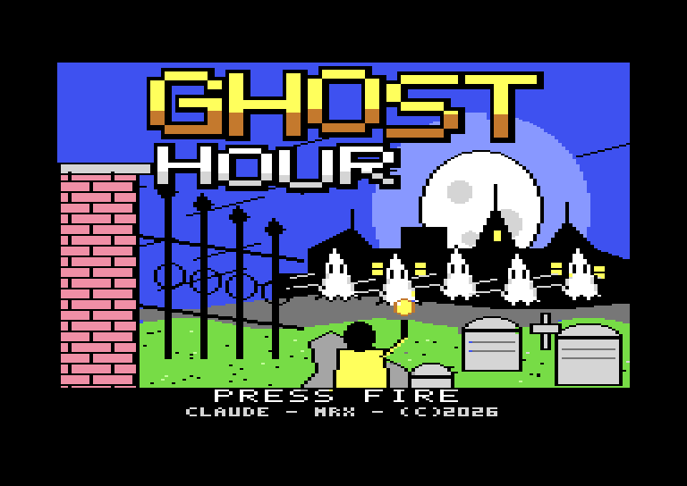 | 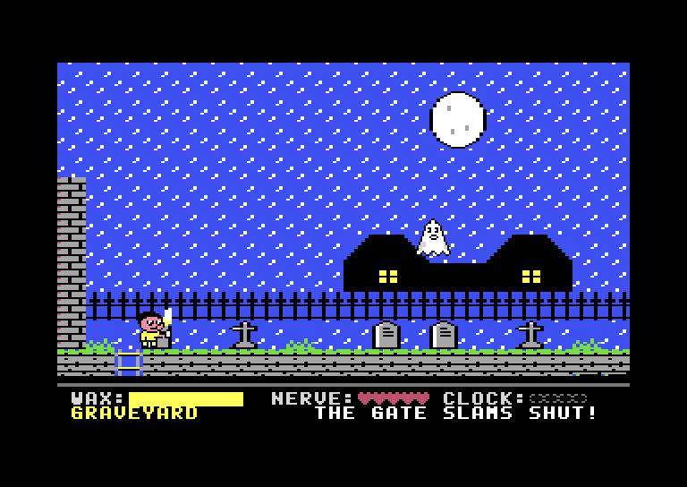 | 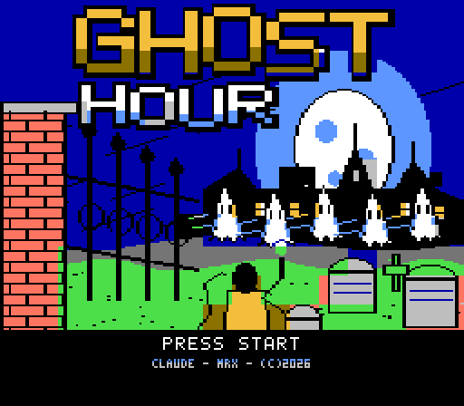 | 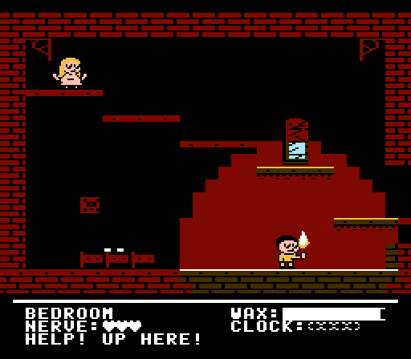 |

## The Vampire Musical

Halloween night at the Grand Theatre: find the 8 pages of the score and free Lola from the Count.

| C64 begin screen | C64 | NES begin screen | NES |
|:---:|:---:|:---:|:---:|
| 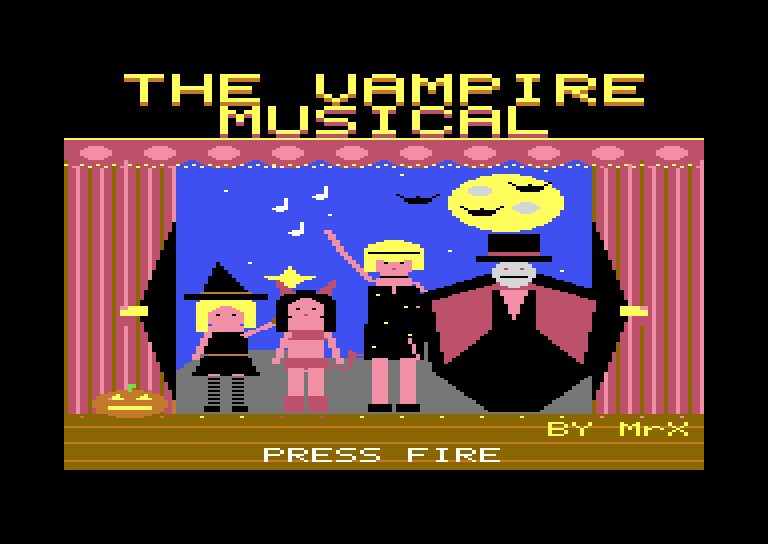 | 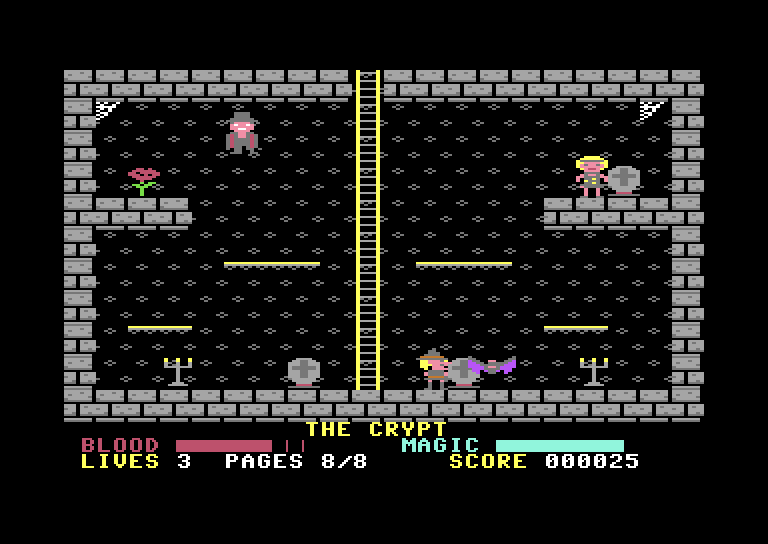 | 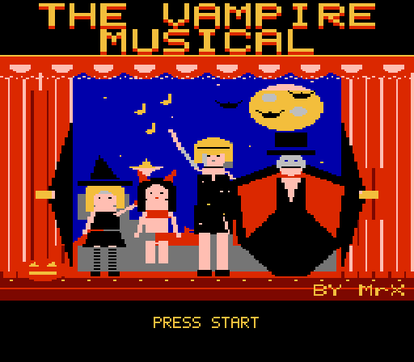 | 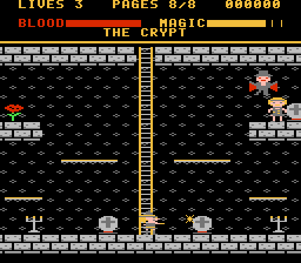 |

## Red Mesa Ranch

UFOs over a desert ranch, from dawn to night: shoot the craft, save the herd, keep the homesteads
standing, and listen to the radio at 1.6 GHz. Inspired by the stories about Skinwalker Ranch.

| C64 begin screen | C64 | NES begin screen | NES |
|:---:|:---:|:---:|:---:|
| 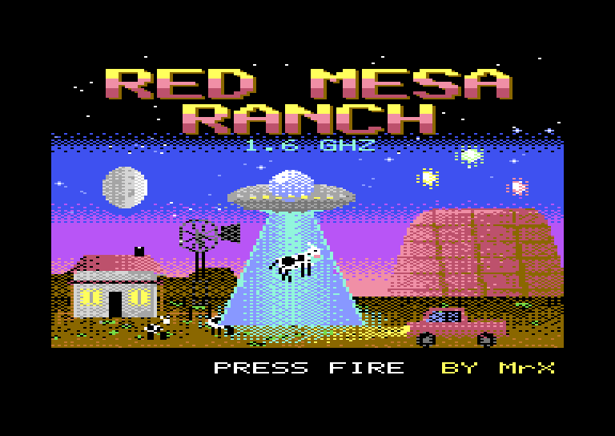 | 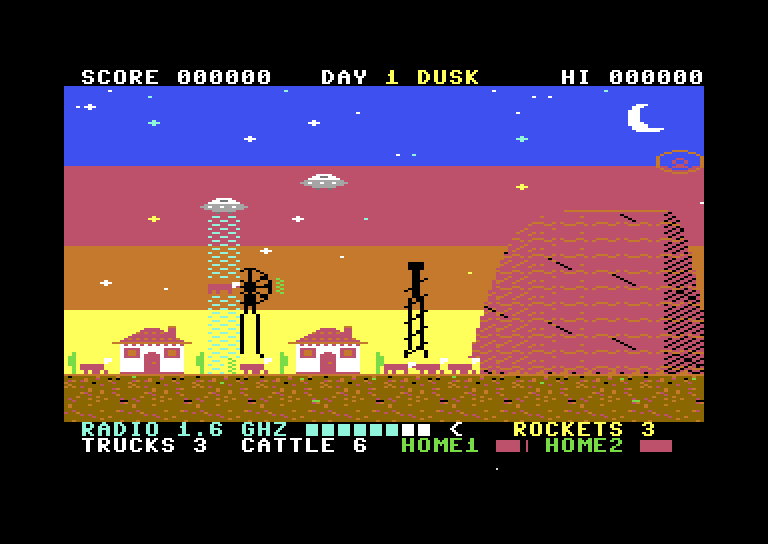 | 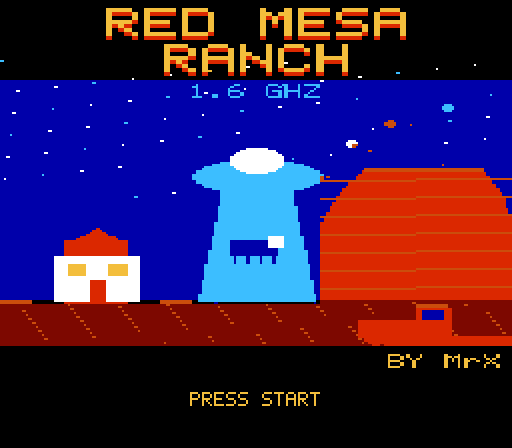 | 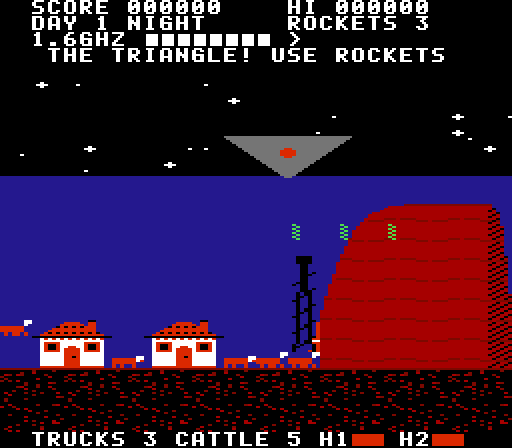 |

## Play in your browser

The links below start each game in [vc64web](https://vc64web.github.io/), a C64
emulator that runs in the browser. The cursor keys and Space (fire) act as
a joystick in port 2.

| Game | Play online | Download |
|------|-------------|----------|
| [Ghost Hour](ghosthour/) | [▶ Play on C64](https://vc64web.github.io/#openROMS=true#port2=true#https://raw.githubusercontent.com/brunokeymolen/c64games/c90fee3bbd5cfbc216c3af3fec196b0d9bd3de98/ghosthour/play/ghosthour.prg) | [.prg](ghosthour/play/ghosthour.prg) · [.d64](ghosthour/play/ghosthour.d64) · [.nes](ghosthour/play/ghosthour.nes) (NES port) |
| [The Vampire Musical](vampire_musical/) | [▶ Play on C64](https://vc64web.github.io/#openROMS=true#port2=true#https://raw.githubusercontent.com/brunokeymolen/c64games/c90fee3bbd5cfbc216c3af3fec196b0d9bd3de98/vampire_musical/play/vampire.prg) | [.prg](vampire_musical/play/vampire.prg) · [.d64](vampire_musical/play/vampire.d64) · [.nes](vampire_musical/play/vampire.nes) (NES port) |
| [Red Mesa Ranch](red_mesa_ranch/) | [▶ Play on C64](https://vc64web.github.io/#openROMS=true#port2=true#https://raw.githubusercontent.com/brunokeymolen/c64games/ccf6d422869d8d23f7379ccb7eaa75bf97ea2324/red_mesa_ranch/play/redmesa.prg) | [.prg](red_mesa_ranch/play/redmesa.prg) · [.d64](red_mesa_ranch/play/redmesa.d64) · [.nes](red_mesa_ranch/play/redmesa.nes) (NES port) |

To play on your own machine, use the downloads with [VICE](https://vice-emu.sourceforge.io/)
(`x64sc ghosthour.prg`) or on real hardware. The `.nes` file runs in any NES
emulator, such as FCEUX or Mesen.

## Games

| Directory | Game |
|-----------|------|
| [`ghosthour/`](ghosthour/) | Ghost Hour, for the C64 with an NES port |
| [`vampire_musical/`](vampire_musical/) | The Vampire Musical, a Halloween platformer, for the C64 with an NES port |
| [`red_mesa_ranch/`](red_mesa_ranch/) | Red Mesa Ranch, a UFO shooter, for the C64 with an NES port |

Each game's README explains how to play it.
