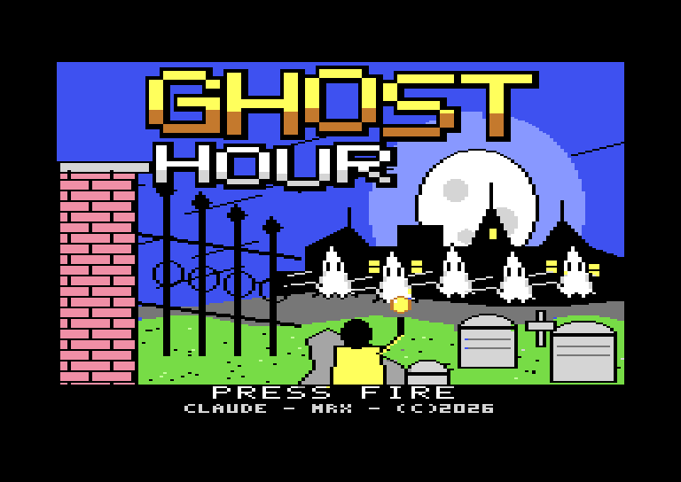
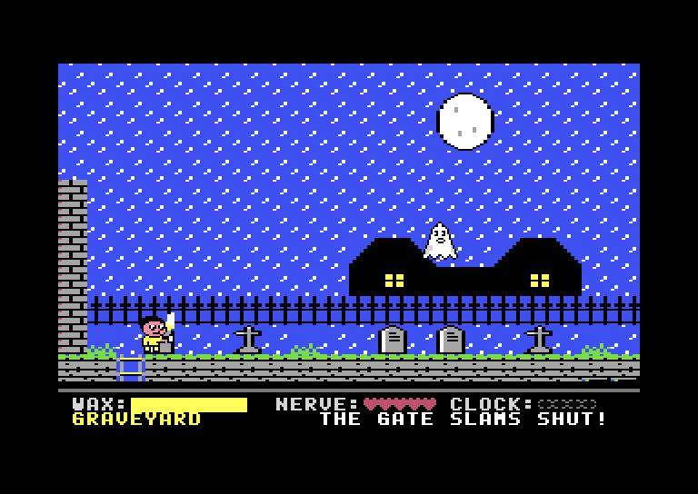
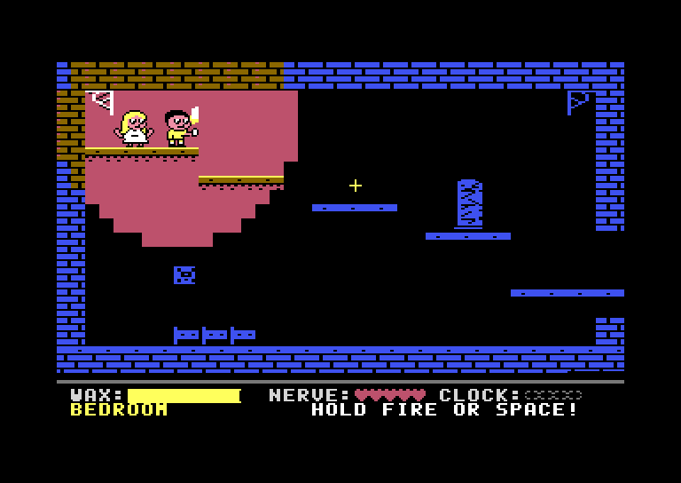
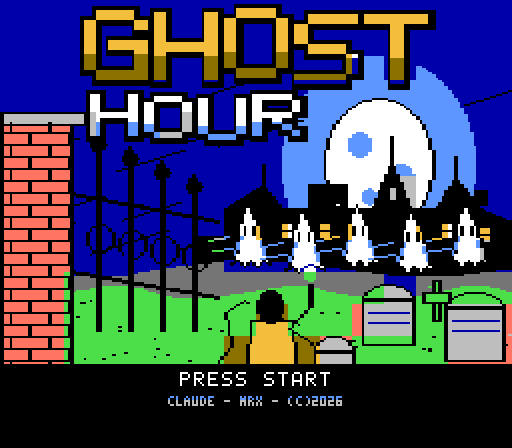
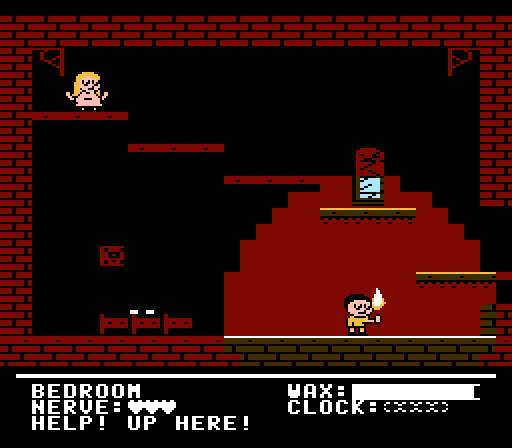

# Ghost Hour

Made using Anthropic Claude Opus 5.5

This is a vibe-code experiment with Claude and 8 bit Commodore 64 game development. The status is 'as is' the game play and code is entirely AI work steered by an initial prompt and a few refinements by a few follow up prompts.

A haunted-manor platformer for the Commodore 64, written in 6502 assembly, for a stock PAL C64 and
tested in the VICE emulator. It is also ported to the NES.

The great clock stopped one minute before midnight, so the hour of the ghosts never ended. You are
a telegram runner in a yellow slicker, caught in the storm. Find the four lost clock parts and bring
them to the clock in the Great Hall.

**[▶ Play in your browser](https://vc64web.github.io/#openROMS=true#port2=true#https://raw.githubusercontent.com/brunokeymolen/c64games/main/ghosthour/play/ghosthour.prg?v=478bca8f)**: runs in the vc64web emulator, with no install. Press SPACE to start.

| Begin screen | Outside | Brooke |
|:---:|:---:|:---:|
|  |  |  |

## Downloads

- [`play/ghosthour.prg`](play/ghosthour.prg): the C64 program, for VICE (`x64sc ghosthour.prg`) or real hardware
- [`play/ghosthour.d64`](play/ghosthour.d64): the same on a 1541 disk image. Loading through the
  emulated drive takes about two minutes unless you turn on warp.
- [`play/ghosthour.nes`](play/ghosthour.nes): the NES port, for any NES emulator

## Playing

| Action                        | Joystick (port 2) | Keyboard |
|-------------------------------|-------------------|----------|
| Walk                          | left / right      | A / D    |
| Jump, climb up                | up                | W        |
| Climb down                    | down              | S        |
| Raise the candle (burns wax)  | fire              | SPACE    |

- **Your candle is your light.** Indoors you only see what it lights, and it dims as the wax burns.
  Wax does not burn outdoors. Lightning briefly shows the whole room.
- **In the dark you only see eyes.** Raising the candle drives off ghosts, bats and wolves nearby,
  but burns wax much faster.
- **Ghosts** drift through walls towards you and cost 1 nerve. **Bats** steal wax instead.
  **Werewolves** patrol the floor and cost 2 nerve. At zero nerve you faint.
- **Candles** refill your wax. The one in the Great Hall comes back each time you re-enter.
- In the dark, a white twinkle marks a clock part and a yellow one a candle. The message row tells you
  when a clock part is in the room. Walk into a part to take it.
- **Brooke** is trapped on the top plank in the Bedroom, with the clock's winding key. Stand beside her
  and hold fire or SPACE for about two seconds. Afterwards she waits by the clock in the Great Hall.

## NES port

The whole game is also ported to the NES: the title screen with its lightning, the story, the 13
rooms in the dark with your candle, ghosts, bats and werewolves, candles and clock parts, Brooke,
the clock, music and sound, and the end screens.

| C64 begin screen | C64 | NES begin screen | NES |
|:---:|:---:|:---:|:---:|
|  |  |  |  |

| Action                        | NES pad     | FCEUX default keys |
|-------------------------------|-------------|--------------------|
| Walk                          | left, right | arrow keys         |
| Jump                          | A or up     | F or up arrow      |
| Climb                         | up, down    | arrow keys         |
| Raise the candle (burns wax)  | B           | D                  |
| Start, go on from a screen    | START or A  | Enter or F         |

If the keys differ on your setup, see Options > Gamepad Config in FCEUX.

Differences from the C64 version:

- **Room width:** the rooms are 16 metatiles wide instead of 20, re-laid by hand.
- **Speeds and timers** are scaled from 50 Hz to 60 Hz, so walking, the 36 px jump and the wax
  burning feel the same.
- **Colour:** the Terrace needs 5 tile colours, so its windows are white.
- **In the dark** the outlines are drawn in the room's wall colour; the C64 uses one dim blue everywhere.
- **Greys:** the NES has no dark grey, so the stone rooms use mid and light grey.
- **Lightning** turns the whole backdrop white, the HUD included, for a frame or two.
- **Sprites** are one 3-colour layer instead of the C64's ink layer over a fill layer. The NES shows
  at most 8 sprites on a line, so when many line up they flicker instead of vanishing.
- **Text screens** are rewrapped to the 28 columns a TV shows, so the lines break differently.
- **Sound:** the NES has two square-wave channels, a triangle and noise instead of the SID's three
  voices with filters and envelopes. The C64 bell has no sustain, so it only ticks there; on the
  NES it rings out.
- **Controls:** fire is B, and jump is A as well as up.

## Authors

- **Claude** (Anthropic)
- **Bruno Keymolen**

## License

Open source under the [MIT License](LICENSE).
