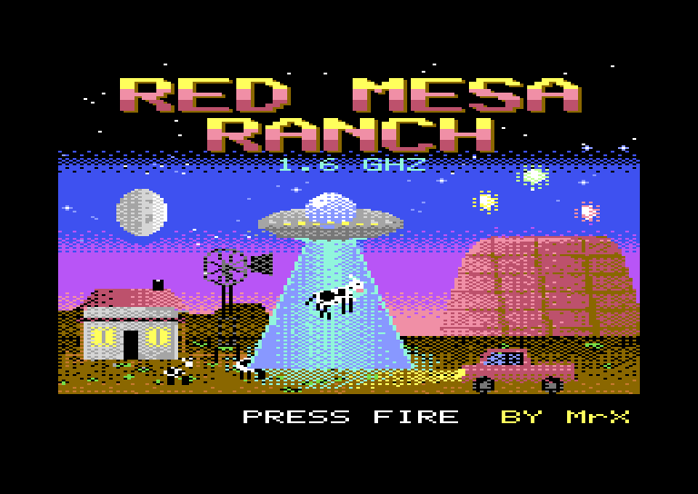
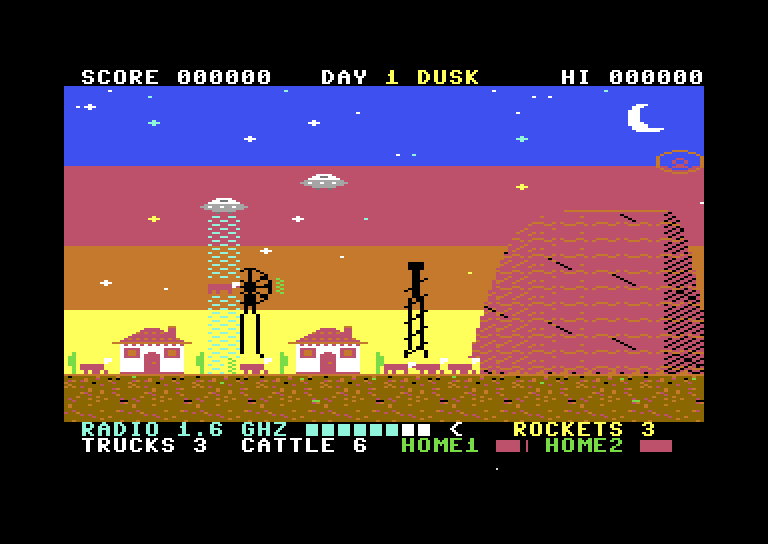
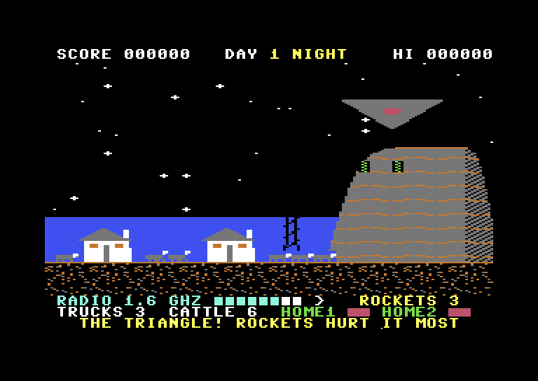
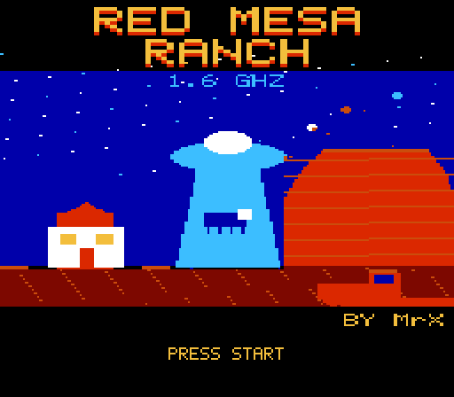
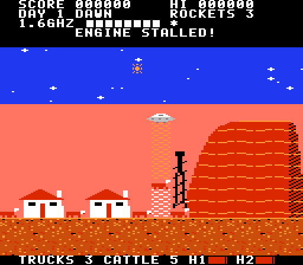
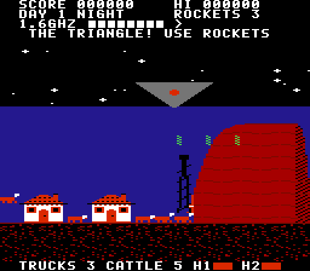

# Red Mesa Ranch

A UFO shooter for the Commodore 64, written in 6502 assembly, with a port to the NES. Inspired by
the stories told about Skinwalker Ranch in Utah's Uintah Basin. Red Mesa Ranch itself is fictional.

From dawn to night, craft come through a rift: weaving orbs out of the one above the mesa, and
saucers that bomb the homesteads and beam the cattle up, through a rift that can open anywhere in
the sky or at the edge of the range. At the end of every night comes the Triangle. Drive your pickup
along the range, shoot them down, save the herd, and keep Homestead 1 and Homestead 2 standing.

**[▶ Play in your browser](https://vc64web.github.io/#openROMS=true#port2=true#https://raw.githubusercontent.com/brunokeymolen/c64games/main/red_mesa_ranch/play/redmesa.prg)**: runs in the vc64web emulator, with no install.

| Begin screen | Dusk | Night |
|:---:|:---:|:---:|
|  |  |  |

## Downloads

- [`play/redmesa.prg`](play/redmesa.prg): the C64 program, for VICE (`x64sc redmesa.prg`) or real hardware
- [`play/redmesa.d64`](play/redmesa.d64): the same on a 1541 disk image
- [`play/redmesa.nes`](play/redmesa.nes): the NES port, for any NES emulator

## Playing

| Action                    | Joystick (port 2) | Keyboard |
|---------------------------|-------------------|----------|
| Drive                     | left, right       | A, D     |
| Rifle                     | fire              | SPACE    |
| Launch a rocket           | up                | W        |

- **The radio.** The meter at the bottom listens at 1.6 GHz: the closer a craft is to your truck,
  the stronger the signal and the faster the beeps, and the arrow points to it. The signal also
  rises when something is about to come through the rift. At night the saucers go dark; then the
  radio is how you find them.
- **Rockets.** You start with 3. Every few craft shot down, a crate of rockets turns up on the
  range: drive over it for 3 more. A rocket steers towards the nearest craft and bursts, hurting
  everything nearby. The Triangle shrugs off bullets but not rockets.
- **The cattle.** A saucer that goes for a cow hovers over it and beams it up. Shoot the saucer
  and the cow drops back down. Stay out of the beam: its field stalls your engine.
- **The homesteads** burn after enough bolts. If both are lost, so is the ranch. You also lose when
  all three trucks are gone.
- **At night** something with red eyes walks the range. Bullets go right through it.
- Each day runs dawn, day, dusk, night, with more craft every day. A day survived pays 500 per cow
  and 1000 per homestead still standing.

## The stories behind it

The game borrows from what is reported about the ranch, without claiming any of it is true:
lights and orbs over the mesa, cattle that vanish, Homestead 1 and Homestead 2, an area called the
Triangle, a signal at 1.6 GHz said to show up during events, rockets launched from the ranch,
electronics that fail, and large red-eyed animals said to be unharmed by bullets. Sceptics point
out, among other things, that 1.6 GHz is a busy band used by satellite phones and navigation. The
ranch's name refers to a figure from Navajo belief; the game leaves that out.

Background reading: [Skinwalker Ranch on Wikipedia](https://en.wikipedia.org/wiki/Skinwalker_Ranch),
[the 1.6 GHz signal](https://forteanwinds.com/2023/03/21/skinwalker-ranch-and-the-mystery-1-6ghz-signal).

## NES port

The whole game on the NES: the title, the story, dawn to night with the sky's colours changing,
orbs, saucers that bomb the homesteads and beam the cattle up, bolts, the stalled engine, rocket
crates, the 1.6 GHz radio, the creature at night, the Triangle, the end of each day with its bonus,
music and sound, and the lost screen.

| Begin screen | A saucer beams a cow | The Triangle at night |
|:---:|:---:|:---:|
|  |  |  |

| Action                      | NES pad     | FCEUX default keys |
|-----------------------------|-------------|--------------------|
| Drive                       | left, right | arrow keys         |
| Rifle                       | B           | D                  |
| Launch a rocket             | A or up     | F or up arrow      |
| Start, go on from a screen  | START, A, B | Enter, F, D        |

How it differs from the C64 version:

- **32 columns.** The C64 screen is 40 columns wide and the game needs all of it in view, so the
  ranch is re-laid for the NES from the same art: a narrower mesa, the homesteads and the drill rig
  closer together, 5 cows instead of 6.
- **The sky** has two colour bands instead of the C64's four, and they change with the time of day.
- **The Triangle** is 64 pixels wide (72 on the C64). Where more than 8 sprites share a line they
  flicker instead of one vanishing.
- **Text** is rewritten for the 28 columns a TV shows.
