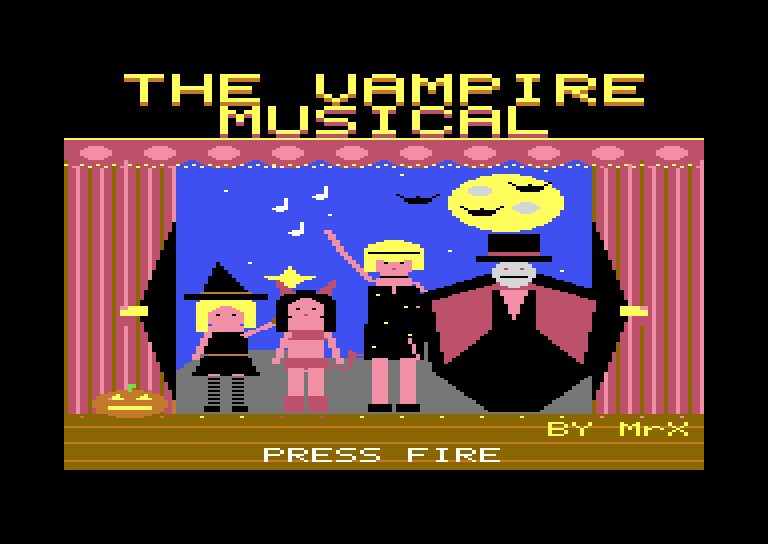
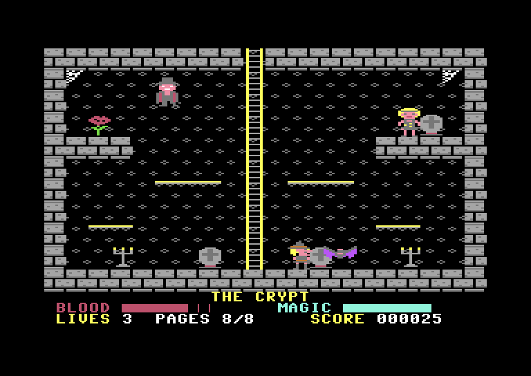
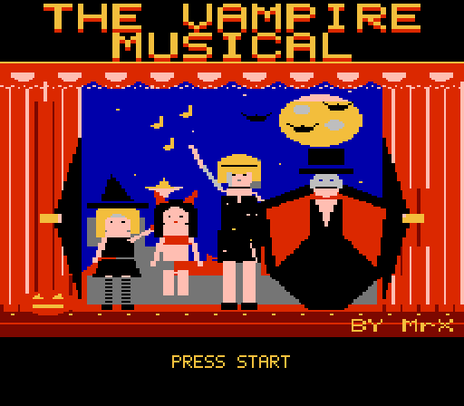
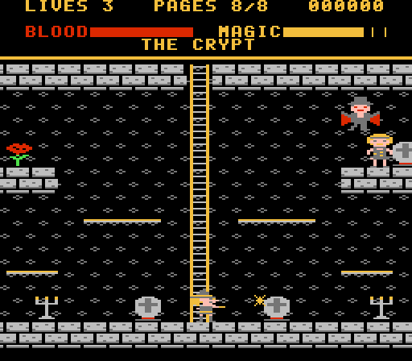

# The Vampire Musical

A Halloween platform game for the Commodore 64, written in 6502 assembly, with a port to the NES.
Brooke (in her witch costume) and her friend Raven must find the 8 pages of the score the
vampires hid around the Grand Theatre, open the stage trapdoor and free Lola from the Count.

**[▶ Play in your browser](https://vc64web.github.io/#openROMS=true#port2=true#https://raw.githubusercontent.com/brunokeymolen/c64games/c90fee3bbd5cfbc216c3af3fec196b0d9bd3de98/vampire_musical/play/vampire.prg)**: runs in the vc64web emulator, with no install.

| C64 begin screen | C64 | NES begin screen | NES |
|:---:|:---:|:---:|:---:|
|  |  |  |  |

## Downloads

- [`play/vampire.prg`](play/vampire.prg): the C64 program, for VICE (`x64sc vampire.prg`) or real hardware
- [`play/vampire.d64`](play/vampire.d64): the same on a 1541 disk image
- [`play/vampire.nes`](play/vampire.nes): the NES port, for any NES emulator

## Playing

Controls: joystick port 2, or W/A/S/D + SPACE. Up = jump (or climb a ladder), fire = magic spark.
Sparks stun the vampire ushers and knock bats down. Talk to Raven in the foyer for a hint and a heal.

## NES port

The whole game on the NES: the title, the story, the 10 rooms of the Grand Theatre, the ushers and
bats, the 8 pages of the score and the roses, Raven, the trapdoor, the Count and Lola in the crypt,
the curtain call, music and sound, and the game over and win screens.

| Action                       | NES pad     | FCEUX default keys |
|------------------------------|-------------|--------------------|
| Walk                         | left, right | arrow keys         |
| Jump                         | A or up     | F or up arrow      |
| Climb                        | up, down    | arrow keys         |
| Magic spark                  | B           | D                  |
| Start, go on from a screen   | START, A, B | Enter, F, D        |

The rooms keep their C64 size: a room is 320 pixels wide and the NES shows 256, so the view
scrolls to follow Brooke. Messages and the story are rewritten for the 28 columns a TV shows.
